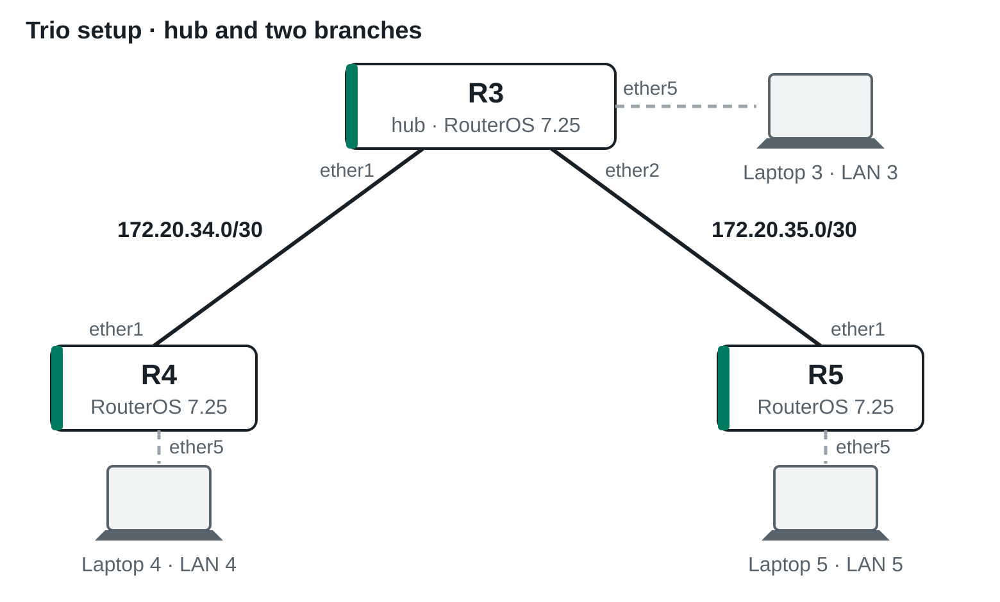
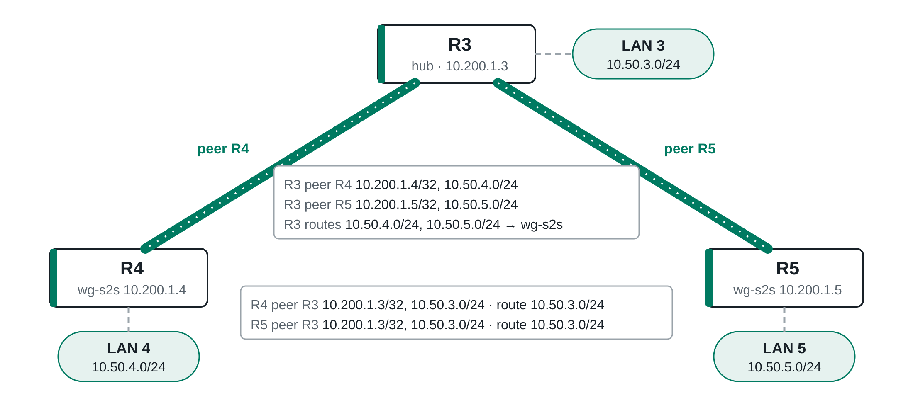

# WireGuard Site-to-Site VPN — Trio setup

**Train the Trainer · RouterOS v7 · Student handout · routers R3 (hub), R4 and R5**

## 1. Topology





## 2. Addressing plan

| Router | Transport | Tunnel wg-s2s | Site LAN (ether5) |
|---|---|---|---|
| R3 — hub | ether1 172.20.34.1/30, ether2 172.20.35.1/30 | 10.200.1.3/24 | 10.50.3.1/24 |
| R4 — branch | ether1 172.20.34.2/30 | 10.200.1.4/24 | 10.50.4.1/24 |
| R5 — branch | ether1 172.20.35.2/30 | 10.200.1.5/24 | 10.50.5.1/24 |

WireGuard port **13231** · interface **wg-s2s** · laptop on ether5 (DHCP)

## 3. Tasks

### 3.0 Prepare your router

Board config you need later? Back it up first and copy both files to your laptop:

```bash
/system backup save name=before-ttt
/export file=before-ttt
```

Download **start-*Rn*.rsc** for your router from [github.com/111REB579/TTT_2026](https://github.com/111REB579/TTT_2026) and drag it into WinBox *Files*. Then:

```bash
/system reset-configuration skip-backup=yes keep-users=yes no-defaults=yes run-after-reset=start-<my router>.rsc
```

Renew the DHCP lease on your laptop (10.50.*n*.x) and reconnect WinBox to 10.50.*n*.1.

```bash
/ip address print
/ping <partner transport address> count=3
```

### 3.1 Create the WireGuard interface

```bash
/interface wireguard add name=wg-s2s listen-port=13231
/interface wireguard print
```

### 3.2 Tunnel address and key swap

```bash
/ip address add address=<my tunnel address>/24 interface=wg-s2s
```

Swap public keys: R3 needs the keys of R4 and R5; R4 and R5 need the key of R3. Compare the last four characters.

### 3.3 Allow WireGuard on the transport

```bash
/ip firewall filter add chain=input action=accept protocol=udp dst-port=13231 in-interface-list=WAN comment="allow WireGuard" place-before=[find comment="defconf: drop all not coming from LAN"]
/ip firewall filter print where chain=input
```

Always check that the port is open: "allow WireGuard" must be **above** "drop all not coming from LAN".

### 3.4 Add the peer

R3: twice, for R4 and for R5.

```bash
/interface wireguard peers add interface=wg-s2s name=<partner> public-key="<partner public key>" endpoint-address=<partner transport address> endpoint-port=13231 allowed-address=<partner tunnel address>/32,<partner site LAN>
/interface wireguard peers print detail
```

### Checkpoint 1 — handshake and tunnel

```bash
/ping <partner tunnel address> count=3
/interface wireguard peers print detail
```

**Pass:** replies; `last-handshake` has a value; `rx` and `tx` grow.
R3: for both branches.

### 3.5 Route the remote LAN

R3: two routes, one per branch LAN.

```bash
/ip route add dst-address=<partner site LAN> gateway=wg-s2s
/ip route print where gateway=wg-s2s
```

### Checkpoint 2 — LAN to LAN, both directions

From the laptop:

```bash
ping <partner LAN gateway>
```

From the router:

```bash
/ping <partner LAN gateway> src-address=<my LAN gateway> count=3
```

**Pass:** replies in both directions.

## 4. Self-check

| | I have seen that … | Where | ✓ |
|---|---|---|---|
| 1 | my laptop has a 10.50.*n*.x address and my partner's transport address answers | 3.0 | ☐ |
| 2 | wg-s2s exists and carries my tunnel address | 3.1–3.2 | ☐ |
| 3 | "allow WireGuard" is above "drop all not coming from LAN" | 3.3 | ☐ |
| 4 | the public key in my peer entry ends with the same 4 characters as my partner's own key | 3.4 | ☐ |
| 5 | `last-handshake` has a value; `rx` and `tx` grow | Checkpoint 1 | ☐ |
| 6 | my partner's tunnel address answers | Checkpoint 1 | ☐ |
| 7 | the route to my partner's LAN is active (`A`) | 3.5 | ☐ |
| 8 | my laptop reaches my partner's LAN, and my partner's laptop reaches mine | Checkpoint 2 | ☐ |

R3 ticks lines 4–8 only when they hold for both R4 and R5.

## 5. Done early? (optional)

Branch to branch through the hub — on R4 and R5 only (*o* = the other branch: 5 on R4, 4 on R5):

```bash
/interface wireguard peers set [find name=R3] allowed-address=10.200.1.3/32,10.50.3.0/24,10.200.1.<o>/32,10.50.<o>.0/24
/ip route add dst-address=10.50.<o>.0/24 gateway=wg-s2s
```

## 6. If something does not work

1. **Transport:** does the partner's transport address answer?
2. **Handshake:** `tx` grows, `rx` stays 0? Check the partner's input rule, the endpoint address and the public key.
3. **Tunnel:** does the partner's tunnel address answer?
4. **Route:** "Destination network unreachable" from your own router? The route is missing.
5. **allowed-address:** tunnel fine, LAN ping times out? The partner's allowed-address does not list your LAN.
6. **Hub:** "allowed-address conflicts other peer"? Each prefix belongs to exactly one peer.

**Did not finish?** In the GNS3 student project (login `admin` / `wg-lab`) the routers are in the state after 3.0: continue with 3.1. To start a router over: `/system reset-configuration skip-backup=yes keep-users=yes no-defaults=yes run-after-reset=start-<router>.rsc`
